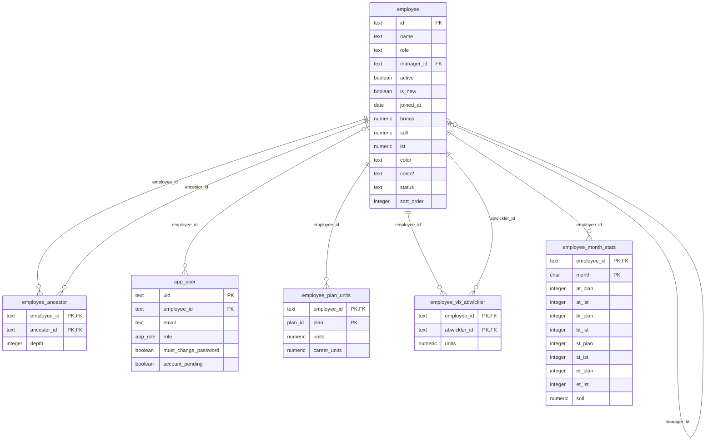
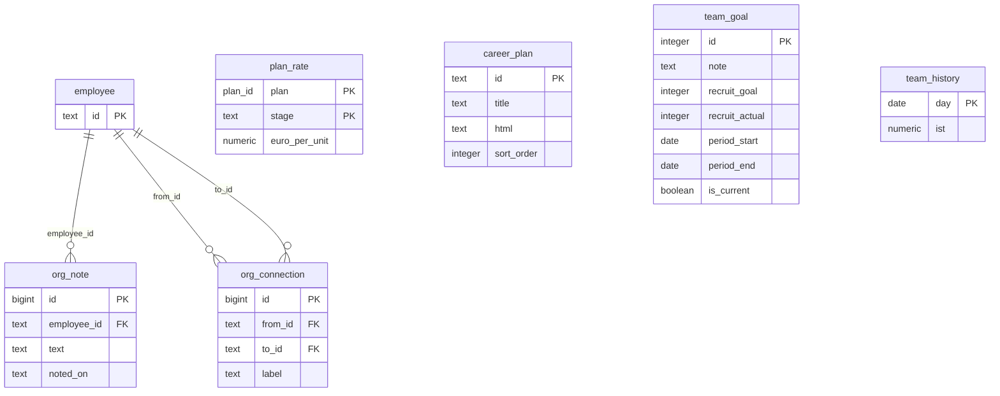
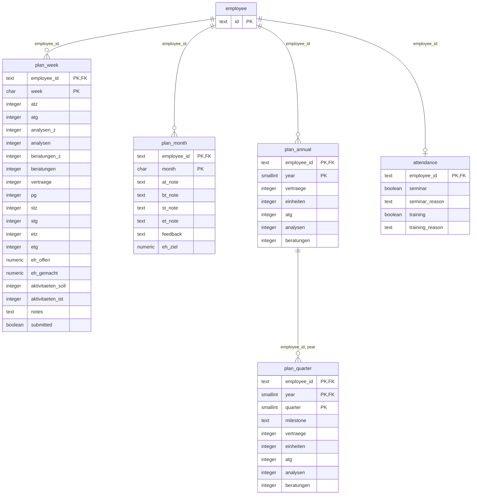
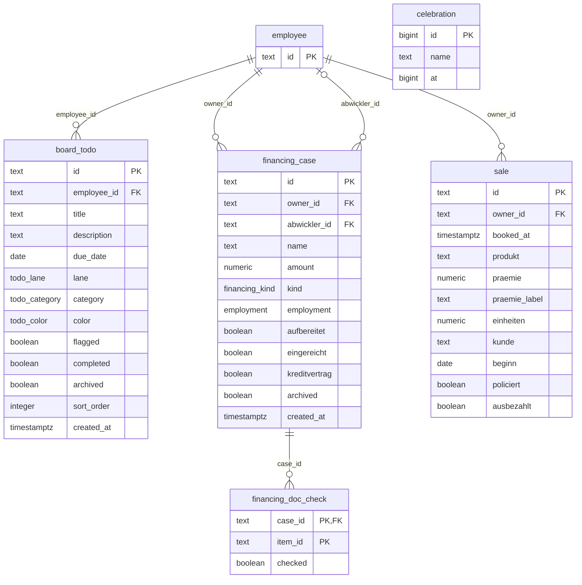
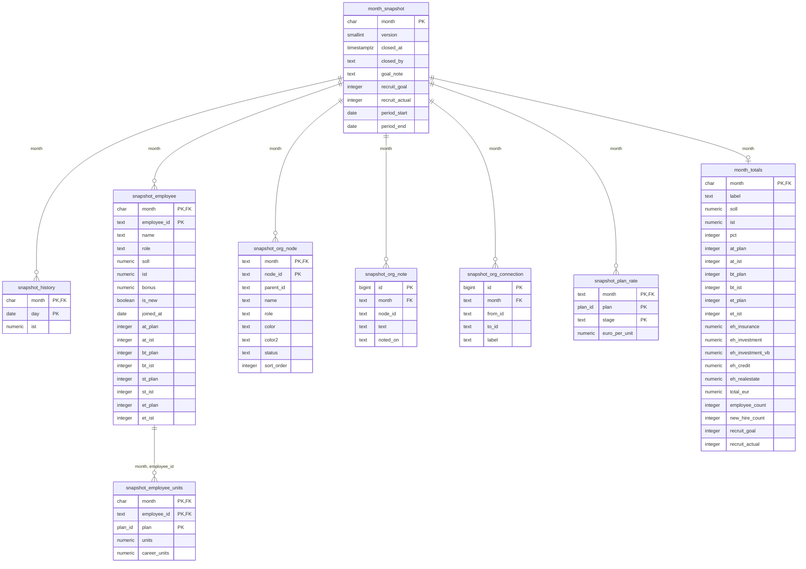

# Datenmodell (PostgreSQL) — Nachbildung der Firestore-Datenbank

Entwurf eines relationalen Modells für das Team-Dashboard. Abgeleitet aus `src/types/*`, `src/lib/calc/format.ts`,
`firestore.rules` und `functions/src`. **Nicht gegen echte Daten oder Finovas bestehendes Schema geprüft.**
Vorhandene Finova-Tabellen (Mitarbeiter, Kunden, Kreditfälle) zuerst abgleichen und dann verknüpfen statt neu anlegen.

- PDF zum Weitergeben: [`Datenmodell_PostgreSQL.pdf`](Datenmodell_PostgreSQL.pdf)
- SQL zum Anlegen: [`schema.postgres.sql`](schema.postgres.sql) (getestet: läuft in PostgreSQL 16 fehlerfrei durch)
- Umfang: 31 Tabellen, 234 Spalten, 29 Fremdschlüssel
- Die Diagramme (Mermaid) sind aus dem laufenden Schema erzeugt, nicht von Hand gezeichnet. Sie rendern in GitHub, VS Code
  (Mermaid-Erweiterung) und auf mermaid.live. Legende: `PK` Primärschlüssel, `FK` Fremdschlüssel; `||--o{` = genau ein Elternteil,
  viele Kinder; `|o--o{` = Elternteil optional.

## Wichtigste Unterschiede zu Firestore
1. **`ancestors` (Array) → `employee_ancestor`**: Firestore prüft Rechte über die gespeicherte Vorgesetztenkette. In SQL ist das eine
   Closure-Tabelle (oder rekursive CTE/`ltree`). Sie muss gepflegt werden, wenn sich `employee.manager_id` ändert
   (heute macht das die Cloud Function `onStructureChange`).
2. **Verschachtelte Objekte → eigene Tabellen**: `ehByPlan`, `careerUnits`, `planRates`, Quartale, Notizen und Verbindungen.
3. **Rechte**: Die Firestore-Regeln (`firestore.rules`) gibt es in PostgreSQL nicht automatisch. Entweder serverseitig in der API
   oder per Row-Level-Security auf `employee_ancestor` aufbauen.
4. **Denormalisierte Werte** (`employee.ist`, `employee_month_stats`, `month_totals`) werden heute serverseitig berechnet; sie können
   Spalten bleiben (mit Job) oder Views werden.
5. **Archiv ohne Fremdschlüssel auf `employee`**: Snapshots sollen auch bestehen bleiben, wenn ein Mitarbeiter später gelöscht wird.

## Zuordnung Firestore → Tabellen
| Firestore | PostgreSQL | Hinweis |
|---|---|---|
| `users/{uid}`, `employees/{id}/private/*` | `app_user` | bei Finova: SSO/bestehende Benutzerverwaltung |
| `employees/{id}` | `employee`, `employee_plan_units`, `employee_vb_abwickler`, `employee_month_stats` | `ehByPlan`/`careerUnits`/`vbByAbwickler`/`monthStats` werden eigene Tabellen |
| `employees/{id}.ancestors` (Array) | `employee_ancestor` | Closure-Tabelle für die Rechteprüfung "Vorgesetzte sehen den Teilbaum" |
| `org/structure` (`tree`, `notes`, `conns`, `planRates`) | `employee` (manager_id, color, status, sort_order), `org_note`, `org_connection`, `plan_rate` | Der Baum ergibt sich aus `manager_id` |
| `org/careerPlans` | `career_plan` |  |
| `org/teamGoal` (`teamGoal`, `history`) | `team_goal`, `team_history` |  |
| `employees/{id}/planWeeks/{YYYY-Www}` | `plan_week` | ein Dokument je Mitarbeiter und Woche |
| `employees/{id}/planMonthNotes/{YYYY-MM}` | `plan_month` |  |
| `employees/{id}/planAnnual/{YYYY}` | `plan_annual`, `plan_quarter` | Quartale waren ein verschachteltes Objekt |
| `employees/{id}/attendance/*` | `attendance` | aktueller Stand je Mitarbeiter |
| `employees/{id}/todos/{id}` | `board_todo` | nur für den Besitzer sichtbar |
| `financings/{caseId}` | `financing_case`, `financing_doc_check` | `ownerId`/`abwicklerId`; `ancestors` entfällt (Closure-Tabelle) |
| `sales/{id}` | `sale` | `ownerId`; nachträglich änderbar: kunde, beginn, policiert, ausbezahlt |
| `celebrations/{id}` | `celebration` | kurzlebig; evtl. Event/WebSocket statt Tabelle |
| `snapshots/{YYYY-MM}` (+ `/employees/{id}`) | `month_snapshot`, `snapshot_*` | unveränderlich nach Monatsabschluss |
| `org/archiveIndex` | `month_totals` | ableitbar, auch als Materialized View möglich |

## Mitarbeiter & Konten

## Organisation, Sätze & Teamziel

## Controlling / Planung

## Fachdaten (Board, Finanzierungen, Umsatz)

## Monatsarchiv

## Offene Punkte
- **Einheiten-Historie:** Firestore hält `ehByPlan` nur für den laufenden Monat; frühere Stände stehen im Archiv. Wenn Finova laufend
  auswerten will, wäre eine Tabelle `unit_booking` (je Buchung) sauberer — `sale` bildet das teilweise schon ab.
- **Schlüsseltypen:** IDs sind in Firestore Strings (z. B. `emp_xyz`). Bei Finova eventuell UUID/Integer — Mapping-Tabelle für die Migration.
- **Rollen:** `employee.role` ist Freitext aus dem Strukturbaum (Karrierestufe), `app_user.role` die Zugriffsrolle. Zusammenhang im
  Code: `src/lib/calc/roles.ts`, `src/lib/calc/struktur.ts`.
